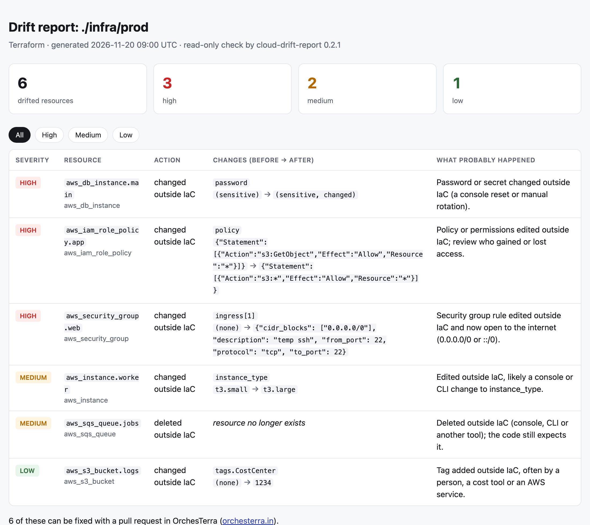

# cloud-drift-report

Open-source Terraform drift detection, and a maintained alternative to driftctl. It finds resources that
someone changed or deleted outside your Terraform, OpenTofu or CloudFormation code, and resources that exist in
your account but no state file or stack knows about. It only reads, ranks findings by severity and explains
each one in plain English.

| | AWS | Azure, GCP, OCI |
|---|---|---|
| Terraform / OpenTofu drift | ✅ | ✅ (any provider `plan -refresh-only` can refresh) |
| CloudFormation drift | ✅ | — |
| Resources not in any IaC | ✅ | planned |

<p align="center">
  
</p>

It ships four ways, from the same code:

- a **command-line tool** (`cloud-drift-report`)
- a **Claude skill** (Claude Code, Claude desktop and claude.ai)
- a **Cursor skill**, plus a Cursor rule for older versions
- a **GitHub Action** (`orchesterra/cloud-drift-report@v0`)

It never writes to AWS or to Terraform state, sends no telemetry and needs no account.

> **Built by [OrchesTerra](https://www.orchesterra.in/?utm_source=drift-skill&utm_medium=oss).** This free tool is a one-off check from your laptop or CI.
> OrchesTerra is the cloud platform that runs it continuously across all your AWS accounts and fixes what
> it finds, with approvals. [Try the live demo](https://app.orchesterra.in/auth/login?demo=1&utm_source=drift-skill&utm_medium=oss) (no sign-up) or [see what it does](#orchesterra-the-full-platform).

## What it checks

| Source | How |
|---|---|
| Terraform / OpenTofu | Runs `plan -refresh-only -lock=false` into a temporary plan file and reads it with `show -json`, or reads a plan JSON you already have. |
| CloudFormation | Runs drift detection on the stacks you name (or every stack in a region), waits for it, then reads the resource drifts. |
| Not in IaC | Lists the account (about 170 resource types, mostly through the AWS Cloud Control API) and compares it with your Terraform state files and CloudFormation stacks. Anything neither lists is reported. |

For each drifted resource you get the address, type, action (changed or deleted outside IaC), each changed
attribute (before → after), a severity, and a short "what probably happened". For each resource not in IaC you
get its name, region, type, ID or ARN and a severity.

The not-in-IaC scan skips what AWS creates itself: default VPCs and their subnets, route tables and security
groups, service-linked roles, AWS-managed keys and policies, resources another AWS service owns (an EKS
cluster security group, an RDS-managed secret, instances launched by an Auto Scaling group), and what AWS
Organizations, Control Tower and StackSets put in member accounts (`OrganizationAccountAccessRole`,
`AWSControlTower*` and `aws-controltower-*`, `stacksets-exec-*`). They are counted in the report's coverage line
but not listed as findings; `--strict` lists them too, as low severity with the reason. Types it could not list
(access denied, or the type needs a parent resource) are named in the JSON output, so you know what was not
checked.

The coverage line starts with the share of listed resources that are in IaC ("87% in IaC"), and the JSON has
the same per resource type. If one cloud resource sits at two Terraform addresses (imported twice), the scan
warns and names both, because two applies would fight over it.

The scan also flags what costs money while doing nothing: a NAT gateway that no route table sends traffic to
(about $33 a month idle in us-east-1, plus $3.65 for each public IPv4 address on it) and an Elastic IP
attached to nothing (about $3.65 a month). A NAT gateway that routes do point at, but that moved under
1 GB in the last 14 days (CloudWatch `BytesOutToDestination` plus `BytesInFromDestination`), is flagged as
nearly unused, at medium severity since it may be a standby; gateways younger than 14 days aren't judged.
Costs use that region's on-demand rates from the AWS Price List API
(`pricing:GetProducts`); if it can't be read, the us-east-1 list price is used and the finding says so. One
that is also not in IaC is reported at high severity with the cost in its explanation; ones your Terraform
does manage are named in the coverage line ("Idle and still billing: ...") and in the JSON's `idle` list,
since being in code doesn't make them free.

When a resource you expect to be in IaC is reported anyway, `--explain TEXT` says, for each listed resource
whose ID, name or ARN contains TEXT, what it matched or why it didn't: no state entry of that type, an entry
recorded for another region, or the values it looked for.

**Severity**

- **High**: security relevant. Security groups and rules, NACLs, IAM, bucket policies, public access,
  ACLs, encryption, KMS, resource policies, passwords.
- **Medium**: any other change that alters behaviour, deleted resources, and most resources not in IaC.
- **Low**: tags only, and log groups an AWS service created for one of your resources.

Formats: Markdown (default), CSV, JSON and a self-contained HTML page (no external assets, light and dark mode,
severity filter).

## Install

You need Python 3.10+. The CloudFormation and not-in-IaC modes also need `boto3`; Terraform mode needs `tofu`
or `terraform` on PATH.

### Command-line tool

```bash
pip install cloud-drift-report
```

Or the latest code from GitHub: `pip install git+https://github.com/orchesterra/cloud-drift-report`.

Or run the script directly with no install:

```bash
python3 skills/cloud-drift-report/scripts/drift_report.py --help
```

### Claude Code plugin

```text
/plugin install cloud-drift-report --marketplace orchesterra/cloud-drift-report
```

On Claude Code older than 2.1.275, run `/plugin marketplace add orchesterra/cloud-drift-report`, then
`/plugin install cloud-drift-report@orchesterra`. In Claude desktop or claude.ai, go to Customize → Plugins →
Add marketplace and enter `orchesterra/cloud-drift-report`.

### Claude skill (without the plugin)

Copy the skill folder into your Claude skills directory:

```bash
cp -r skills/cloud-drift-report ~/.claude/skills/
```

Then ask Claude: *"check drift in ./infra"*, *"make a drift report for my CloudFormation stacks in us-east-1"*,
*"what changed outside Terraform?"* or *"what in this account isn't in Terraform?"*

### Cursor skill

Cursor versions with Agent Skills read the same folder:

```bash
mkdir -p ~/.cursor/skills && cp -r skills/cloud-drift-report ~/.cursor/skills/
```

For older Cursor versions, copy the rule into your project instead:

```bash
mkdir -p .cursor/rules && cp cursor/rules/cloud-drift-report.mdc .cursor/rules/
```

## Credentials

The tool never asks for, stores or sends credentials. It uses whatever is already set up on the machine,
through the standard AWS credential chain (the same one the AWS CLI uses):

| How you sign in | How to run it |
|---|---|
| SSO (IAM Identity Center), recommended | `aws sso login --profile prod`, then `--profile prod` |
| Assume-role profile (`role_arn` + `source_profile` in `~/.aws/config`) | `--profile <name>` |
| Access keys in `~/.aws/credentials` | `--profile <name>`, or nothing for `default` |
| Environment variables (`AWS_ACCESS_KEY_ID`, `AWS_PROFILE`, ...) | no flag needed |
| CI with OIDC (GitHub Actions, GitLab), or an EC2/ECS/Lambda role | no flag needed |

Terraform/OpenTofu mode runs `tofu` or `terraform`, so the provider reads its own credentials: `--profile`
there sets `AWS_PROFILE` for the AWS provider; Azure, GCP and OCI providers use their usual environment
variables or CLI login (`az login`, `gcloud auth application-default login`, `~/.oci/config`).

Prefer SSO or a role over long-lived access keys. The AWS managed `ReadOnlyAccess` policy covers everything
the tool reads; see [Safety](#safety) for the exact calls.

### Another account: `--role-arn`

`cloudformation` and `unmanaged` can assume a role first, so one set of credentials checks any account that
trusts it:

```bash
cloud-drift-report unmanaged --region us-east-1 \
  --role-arn arn:aws:iam::222222222222:role/drift-report-readonly --external-id "$EXTERNAL_ID" \
  --state s3://acme-tf-state/prod/
```

The role needs `ReadOnlyAccess` (or less; see [Safety](#safety)) and a trust policy for your caller.
`--external-id` is optional; `--role-session-name` (default `cloud-drift-report`) is what the target
account's CloudTrail shows. Credentials renew during long scans. An `s3://` state is read with your own
credentials first, since state usually lives in a central account, and then as the role. Terraform/OpenTofu
mode leaves roles to your provider configuration.

### In GitHub Actions

Use the action. It posts the report on the run's summary page, keeps the HTML, Markdown and JSON reports as
an artifact, and fails the job when something drifted or is not in IaC. With GitHub's OIDC and a read-only
role, no keys are stored:

```yaml
name: drift-report
on:
  schedule: [{ cron: "0 6 * * 1-5" }]   # weekdays 06:00 UTC
  workflow_dispatch:
permissions:
  id-token: write   # for OIDC
  contents: read
jobs:
  drift:
    runs-on: ubuntu-latest
    steps:
      - uses: actions/checkout@v4
      - uses: aws-actions/configure-aws-credentials@v4
        with:
          role-to-assume: arn:aws:iam::123456789012:role/drift-report-readonly
          aws-region: us-east-1
      - uses: orchesterra/cloud-drift-report@v0
        with:
          mode: unmanaged
          args: --region us-east-1 --state s3://acme-tf-state/prod/
```

To check several accounts from one CI role, add `--role-arn arn:aws:iam::<account>:role/drift-report-readonly`
to `args`, one job per account (a matrix works well).

Terraform/OpenTofu drift: add `hashicorp/setup-terraform` or `opentofu/setup-opentofu` and run `init`, then use
`mode: terraform` with `args: --dir ./infra`. CloudFormation: `mode: cloudformation` with
`args: --region us-east-1`.

| Input | Default | |
|---|---|---|
| `mode` | (required) | `terraform`, `cloudformation` or `unmanaged` |
| `args` | | the mode's flags, as on the command line |
| `fail-on-drift` | `true` | fail the step when anything is found |
| `upload-report` | `true` | keep the reports as a workflow artifact |
| `report-name` | `cloud-drift-report` | the artifact's name |

Outputs: `findings` (count), `high` (high-severity count) and `report-dir` (folder with `report.html`,
`report.md` and `report.json`), for example to post to Slack only when `high` is not `0`.

Without the action: `pip install cloud-drift-report`, then run the CLI with `-o report.html -o report.md`
(each file takes the format of its extension) and `--fail-on-drift`. The action reads a `.driftignore` in the
working directory; add `--ignore path/to/file` to `args` for another location.

## Examples

```bash
# Terraform/OpenTofu directory (must already be initialised), Markdown to the terminal
AWS_PROFILE=prod cloud-drift-report terraform --dir ./infra

# An existing plan file
tofu plan -refresh-only -out=plan.out && tofu show -json plan.out > plan.json
cloud-drift-report terraform --plan-json plan.json --format html -o drift.html

# CloudFormation: two stacks, or every stack in a region
cloud-drift-report cloudformation --profile prod --region us-east-1 --stack payments-api --stack network
cloud-drift-report cloudformation --profile prod --region us-east-1 --format csv -o drift.csv

# Not in IaC: compare us-east-1 with every state file under an S3 prefix and all CloudFormation stacks
cloud-drift-report unmanaged --profile prod --region us-east-1 --state s3://acme-tf-state/prod/

# Not in IaC across every enabled region, several state sources, HTML report
cloud-drift-report unmanaged --profile prod --all-regions \
  --state s3://acme-tf-state/ --state ./legacy/terraform.tfstate --format html -o not-in-iac.html

# CI: exit code 2 when drift (or a resource not in IaC) is found
cloud-drift-report terraform --dir ./infra --fail-on-drift
```

Exit codes: `0` ok, `1` error, `2` drift or a resource not in IaC found with `--fail-on-drift`.

`--state` takes a local `.tfstate` file, `s3://bucket/key.tfstate`, `s3://bucket/prefix/` (every `.tfstate`
under it) or an initialised Terraform directory (read with `state pull`). It may repeat. Without `--state`,
only CloudFormation stacks count as IaC.

## Ignoring findings: `.driftignore`

Put a `.driftignore` in the Terraform directory or the folder you run from (or pass `--ignore FILE`). The
syntax is driftctl's, so an existing driftctl file works as it is:

```gitignore
# whole resources: <type>.<id>, where * and ? are wildcards; a bare type means every resource of that type
aws_s3_bucket.cloudtrail-logs-*
aws_iam_role.*
AWS::SQS::Queue.*DLQ
# one attribute (Terraform and CloudFormation drift): <type>.<id>.<attribute path>
aws_instance.i-0abc123.tags.LastPatched
aws_security_group.*.ingress
# a dot that is part of the id needs a backslash when an attribute follows
aws_s3_bucket.logs\.example\.com.tags
# any resource with a tag (tag:Key matches any value)
tag:ManagedBy=karpenter
# exceptions: later lines win, as in .gitignore
!aws_iam_role.prod-admin
```

`<id>` can be the AWS id, the ARN or its last part, the Terraform resource name or address, or the
CloudFormation logical id. Ignored findings leave the totals and don't fail `--fail-on-drift`, but every report
says how many were ignored and the JSON lists each one with the rule that matched. `--no-ignore` shows
everything. A line that isn't a valid rule prints a warning with its line number and is skipped.

Resources that controllers and AWS services create for you are the usual noise in the not-in-IaC scan:

```gitignore
# AWS Load Balancer Controller (EKS ingresses and services): load balancers, target groups, security groups
tag:elbv2.k8s.aws/cluster
# EC2 nodes Karpenter launches
tag:karpenter.sh/nodepool
# log groups Lambda creates on first run (they carry no tags)
aws_cloudwatch_log_group./aws/lambda/*
```

Resources in CloudFormation stacks already count as IaC, because the scan reads your stacks; add
`tag:aws:cloudformation:stack-name` only for stacks in regions you don't scan, or with `--no-cloudformation`.

To accept what exists today and report only what's new from now on, write a baseline:

```bash
cloud-drift-report unmanaged --region us-east-1 --state s3://acme-tf-state/prod/ -f driftignore -o .driftignore
```

Each line has a comment above it saying what was found; delete a line to report that resource again.
Rules already in the file are kept at the top, so running it again only adds what's new.

## Sample output

```text
# Drift report: ./infra/prod

**6 drifted resources** · high: 3 · medium: 2 · low: 1

| Severity | Resource                   | Action              | Changes (before → after)                                   | What probably happened |
|----------|----------------------------|---------------------|------------------------------------------------------------|------------------------|
| HIGH     | aws_security_group.web     | changed outside IaC | ingress[1]: (none) → {"cidr_blocks": ["0.0.0.0/0"], ... 22} | Security group rule edited outside IaC and now open to the internet. |
| HIGH     | aws_iam_role_policy.app    | changed outside IaC | policy: s3:GetObject → s3:*                                 | Policy or permissions edited outside IaC; review who gained or lost access. |
| MEDIUM   | aws_instance.worker        | changed outside IaC | instance_type: t3.small → t3.large                          | Edited outside IaC, likely a console or CLI change to instance_type. |
| MEDIUM   | aws_sqs_queue.jobs         | deleted outside IaC | resource no longer exists                                   | Deleted outside IaC; the code still expects it. |
| LOW      | aws_s3_bucket.logs         | changed outside IaC | tags.CostCenter: (none) → 1234                              | Tag added outside IaC. |
```

Full samples in every format are in [`examples/`](https://github.com/orchesterra/cloud-drift-report/tree/main/examples): Terraform
([md](https://github.com/orchesterra/cloud-drift-report/blob/main/examples/terraform-drift.md), [csv](https://github.com/orchesterra/cloud-drift-report/blob/main/examples/terraform-drift.csv), [json](https://github.com/orchesterra/cloud-drift-report/blob/main/examples/terraform-drift.json),
[html](https://github.com/orchesterra/cloud-drift-report/blob/main/examples/terraform-drift.html)) and CloudFormation
([md](https://github.com/orchesterra/cloud-drift-report/blob/main/examples/cloudformation-drift.md), [csv](https://github.com/orchesterra/cloud-drift-report/blob/main/examples/cloudformation-drift.csv),
[json](https://github.com/orchesterra/cloud-drift-report/blob/main/examples/cloudformation-drift.json), [html](https://github.com/orchesterra/cloud-drift-report/blob/main/examples/cloudformation-drift.html)) and not in IaC
([md](https://github.com/orchesterra/cloud-drift-report/blob/main/examples/not-in-iac.md), [csv](https://github.com/orchesterra/cloud-drift-report/blob/main/examples/not-in-iac.csv), [json](https://github.com/orchesterra/cloud-drift-report/blob/main/examples/not-in-iac.json),
[html](https://github.com/orchesterra/cloud-drift-report/blob/main/examples/not-in-iac.html)).
Regenerate them with `python3 examples/generate.py`.

## Safety

- Terraform: only `plan -refresh-only -lock=false` and `show -json` (plus a read-only `state pull` when the
  not-in-IaC scan's `--state` is a directory). No `apply`, `import`, `refresh` or state-changing `state` commands. The plan file goes to a temporary folder and is deleted. Sensitive values are masked.
- CloudFormation: `DetectStackDrift`, `DescribeStackDriftDetectionStatus`, `DescribeStackResourceDrifts`
  and `ListStacks`. Drift detection records a check on the stack; nothing else changes.
- Not in IaC: only List, Describe and Get calls (Cloud Control `ListResources`, plus a few service list calls
  such as `ec2:DescribeVpcs` and `iam:ListRoles`), `cloudformation:ListStackResources`, and reads of the state
  files you name. When something idle is found, `pricing:GetProducts` reads its region's price.
  `cloudwatch:GetMetricData` reads routed NAT gateways' traffic. State files
  are read in memory and never printed or saved.
- Uses your own credentials (see [Credentials](#credentials)). The AWS managed `ReadOnlyAccess` policy is enough, plus
  `cloudformation:DetectStackDrift` for CloudFormation drift and whatever read permissions your Terraform
  provider needs to refresh.

## See a report in OrchesTerra

Save the report as JSON (`-f json -o report.json`) and drop the file on OrchesTerra's
[import page](https://app.orchesterra.in/cloud-operations?section=settings&tab=import-report&utm_source=drift-skill&utm_medium=oss)
(free 14-day trial). It shows as a read-only snapshot, and you can connect the account to keep it up to date and
fix findings from there. The CLI never uploads anything itself: when it writes a JSON report it prints the link,
and `--share` prints the same instructions.

## Why we built it

[driftctl](https://github.com/snyk/driftctl) used to be the go-to free drift checker, but it is no longer
actively maintained. Terraform and OpenTofu can now detect drift themselves with `plan -refresh-only`, and
CloudFormation has drift detection built in, but both print raw output that is hard to triage, and neither
tells you about resources your code never knew about. This tool turns the first into a short, ranked report,
finds the second by listing the account, and lets Claude or Cursor explain both.

The account listing and the rules for what AWS owns come from
[OrchesTerra](https://www.orchesterra.in/?utm_source=drift-skill&utm_medium=oss)'s own drift scanner, simplified
to run as a single command.

## OrchesTerra: the full platform

This tool tells you what has drifted and what is not in code, once. [OrchesTerra](https://www.orchesterra.in/?utm_source=drift-skill&utm_medium=oss) is a hosted
platform for AWS that keeps doing it, fixes what it finds, and runs the rest of your infrastructure workflow
in one place.

| | cloud-drift-report (free) | OrchesTerra (paid, cloud) |
|---|---|---|
| Drift in Terraform/OpenTofu and CloudFormation | ✅ one run | ✅ scheduled scans, history and trends |
| Resources not in any IaC | ✅ one run | ✅ continuous, every AWS service |
| Accounts and regions | one per run | many accounts and regions in one view |
| Alerts | — | Slack and email |
| Fix drift | — | restore to code, or accept the change into code |
| Bring unmanaged resources into code | — | adopt into Terraform or a CloudFormation stack, with the import done for you |
| Approvals and safety | — | approvals for risky changes, critical resources protected |
| Team access | — | workspaces, roles and an audit log |

**What else OrchesTerra does**

- **Drift and adoption**: scans Terraform and CloudFormation on a schedule, and restores, accepts or adopts each finding with one click and an approval step.
- **Provisioning**: AWS service forms and a visual designer that produce reviewed Terraform, with plan
  previews, cost estimates and quota checks before anything is applied.
- **Pull request checks**: the plan and its cost impact posted on GitHub, GitLab and Bitbucket pull requests.
- **Policy and compliance**: a policy catalog with guardrails mapped to common frameworks, custom rules,
  exceptions, and checks on existing infrastructure.
- **Cost control**: budgets with alerts, cost estimates on every change, and auto-destroy for temporary
  environments.
- **Disaster recovery**: a readiness score per application and scheduled DR drills.
- **Platform tools**: a private Terraform module registry, shared variable sets, scheduled runs, and an MCP
  server so Claude and other AI tools can read your estate.

Start with a 14-day free trial; paid plans start at $99 a month. See [pricing](https://www.orchesterra.in/pricing?utm_source=drift-skill&utm_medium=oss), or
[open the live demo](https://app.orchesterra.in/auth/login?demo=1&utm_source=drift-skill&utm_medium=oss) to look around a sample workspace without signing up.

## Development

```bash
pip install -e '.[test]'
pytest
```

The tests use a fake refresh-only plan, a fake CloudFormation client and a fake AWS session, so they need no
AWS access.

## Licence

Apache-2.0. See [LICENSE](https://github.com/orchesterra/cloud-drift-report/blob/main/LICENSE).
